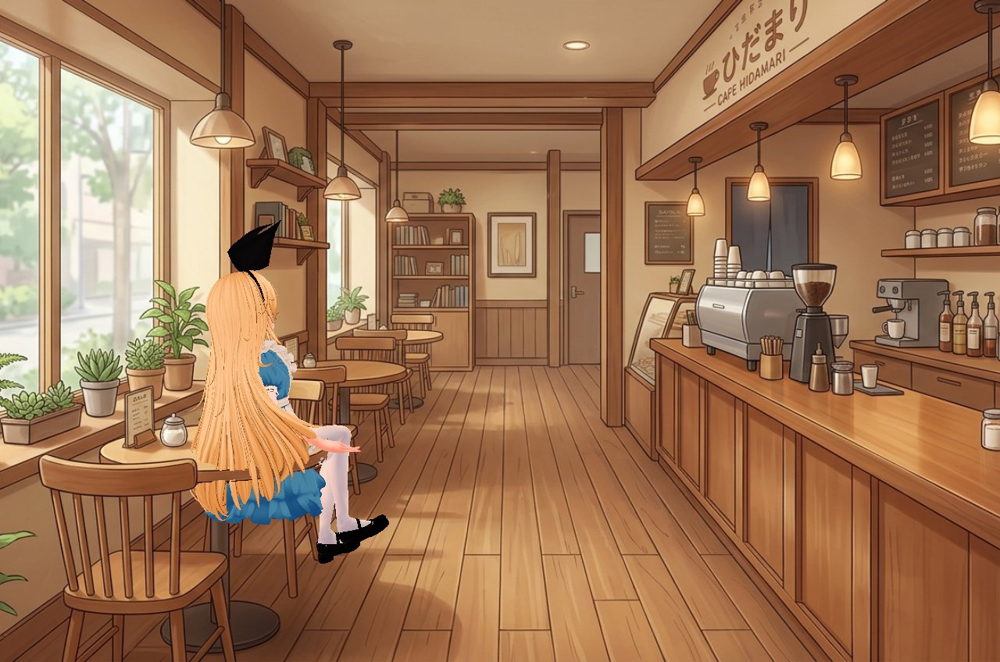

# AlicePet · Apple Silicon 原生超轻量 3D VRM AI 桌面伴侣 / 桌宠

**AlicePet** 是一款面向 **macOS（Apple Silicon）** 的纯原生超轻量 **3D VRM 桌面伴侣 / 桌宠（Desktop Pet & AI Virtual Companion）**，基于 **Swift + Metal + `VRMMetalKit`** 构建，零 Electron、零 Unity、零常驻重型运行时。

它不仅可以在透明置顶窗口中陪伴挂机，还支持**单图深度估计「画中世界（Picture-World）」**——把任意一张 2D 二次元插画或房间照片变成带真实硬件深度遮挡的 3D 交互房间，再结合 **ARDY Mini 20fps 文本生成全身动作**、**Audio2Face-3D 情绪口型与 8 轴情绪惯性状态机**、**标准 `.vrma` 动画**以及 **ZeroClaw + MCP 开放大脑底座**，让 VRM 角色真正「看见房间、理解空间、带着情绪走过去坐下并记住与你相处的一切」。

> 架构设计：[docs/ARCHITECTURE.md](docs/ARCHITECTURE.md) · 路线图：[docs/ROADMAP.md](docs/ROADMAP.md) · 协作规范：[AGENTS.md](AGENTS.md)
> 实时进度看板：[GitHub Projects v2](https://github.com/users/fanfan343/projects/1) · [Milestones](https://github.com/fanfan343/AlicePet/milestones) · [Issues](https://github.com/fanfan343/AlicePet/issues)

<p align="center">
  
  <br />
  <sub>画中世界（Mode 2）实机截图：任意一张 2D 咖啡馆插画经 MoGe-2 单图深度估计与边缘遮挡细化后，Alice 自主避障走到餐桌旁落座，桌椅自然遮挡前后景。</sub>
</p>

---

## 核心特性（已落地能力）

> 项目仍在持续高速迭代中，以下核心模块均已在 Apple Silicon 真机完成构建与端到端验收：

- **Apple 原生极致轻量身体（Swift + Metal）**
  - 纯原生 SwiftPM + Metal 4× MSAA 渲染 + `VRMMetalKit`（MToon 卡通光照/描边 + SpringBone 物理），透明无边框桌宠窗口常驻低功耗。
  - 重型 AI 能力全部解耦到 `services/` 作为按需启停的进程外子服务——**不开即 0 VRAM**。
- **ARDY 轻量实时全身动作生成 + 三层动画混合器**
  - 集成 **ARDY Mini（Core40 ONNX）** 实现 20fps 文本驱动全身动作实时流式生成（60fps SLERP 插值推流），内置**比例 2-Bone Arm IK** 与防穿模约束，解决手腕翻转、拍手交叉与裙摆掀翻。
  - **三层解耦混合器（`AnimationMixer`）**：Layer 0（Author Pose / 标准 `.vrma` / ARDY / 外部 VMC，0.35s 平滑 SLERP 过渡）+ Layer 1（程序化说话手臂/手腕节拍 + 情绪微体态 + 头部微动）+ Layer 2（口型 / 上脸 / 视线眨眼三轨独立）。
- **单图深度估计「画中世界（Picture-World）」**
  - 拖入任意一张 2D 插画或照片，通过 **MoGe-2** 单图度量深度估计 + **RGB 引导深度边缘细化**（消除边缘光晕）+ 二次曲面地面拟合 + 2D 可走网格，直接写入 Metal 硬件 `depth32Float` 缓冲实现真实前后景遮挡。
  - 支持 **VLM 视觉自主识座**（`observe_scene` → 2D `(u, v)` 深度反投影写入 `scene.json` → **A* 避障自动走去坐下**），以及 **0 场景显存的「空透明房间」模式**，可纯透明观察 ARDY 自由动作。
- **面部表情、52 通道 ARKit 口型与连续情绪惯性控制**
  - 支持 **NVIDIA Audio2Face-3D v2.3.1（Claire ONNX）** 10 维原生情绪 + 52 ARKit PerfectSync 表情，以及 **LAM Audio2Expression** 轻量口型与本机 **MediaPipe** 摄像头精捕（面部 + 上半身 + 十指 30 关节）。
  - 内置 **8 组对立轴连续情绪惯性状态机**（`joy↔sadness`、`affection↔rejection`、`excitement↔calm`、`curiosity↔boredom` 等），情绪随时间指数衰减并同时联动表情、A2F-3D 情绪向量与 Layer 1 微体态。
- **开放 Agent 大脑底座（ZeroClaw + MCP + 两段式记忆）**
  - 主 App 使用 Apple `Network.framework` 原生暴露本地控制桥（`127.0.0.1:39550`），通过纯 Python 标准库 **MCP Server（`services/bridge/alicepet_mcp.py`）** 接入 **ZeroClaw（Rust）** 或任意其他支持 MCP 的 Agent Harness。
  - 采用纯 Markdown **两段式记忆**（`SOUL.md` / `PROFILE.md` / `MEMORIES.md` / `TODO.md` + `episodes/YYYY-MM-DD.md` 定期折叠）与低频自主心跳。

---

## 进度看板（Progress Dashboard）

### 1. 四种产品形态（4 Modes）

| 形态 | 名称 | 状态 | 说明 |
| :--- | :--- | :--- | :--- |
| **Mode 1** | 普通桌宠模式 | ✅ 已上线 | 透明置顶陪伴，支持鼠标旋转/平移/缩放视角、换装、表情、`.vrma` 与物理 |
| **Mode 2** | 画中模式（Picture-World） | ✅ 核心完成 | 2D 插画/照片（及**空透明房间**）+ MoGe-2 硬件深度遮挡 + A* 避障 + VLM 自主识座落座；用户仅缩放/中键观察，角色动作由 AI 自主驱动 |
| **Mode 3** | Apple 原生对话 UI | 🗓️ 预留规划 | Apple 原生独立聊天窗口，共享同一份会话与记忆（暂缓，先打磨语音闭环） |
| **Mode 4** | 纯状态栏极简模式 | 🗓️ 预留规划 | 仅保留顶部状态栏图标与小工具面板（Todo / 剪贴板 / 额度 / 系统状态） |

### 2. 阶段里程碑总览

| 阶段 | 里程碑主题 | 状态 | 核心交付 |
| :--- | :--- | :--- | :--- |
| **Stage 1–4** | 身体渲染、三层混合器与画中世界 | ✅ 100% | Swift+Metal 4× MSAA、三层 `AnimationMixer`、ARDY 20fps + 2-Bone IK、A2F-3D Claire、MoGe-2 深度轮廓贴边遮挡、A* 导航走去坐下 |
| **Stage 5** | Harness 大脑底座与「虚拟生命」闭环 | ✅ 100% | `LocalControlServer`（`Network.framework`）、纯 stdlib MCP 桥、`ZeroClaw` 底座、两段式 Markdown 记忆、8 轴连续情绪惯性状态机 |
| **Stage 6** | 表现力深化与语音闭环 | 🚧 进行中 (3/5) | ✅ 标准 `.vrma` 播放 + Layer 1 说话手势节拍与情绪微体态<br>✅ 画中模式空透明房间（0 场景显存）<br>✅ VLM 零预设锚点自主识座落座验收<br>⬜ 本地语音通话闭环（STT + Smart Turn + TTS → A2F-3D）<br>⬜ 动态帧率省电策略与多 VRM 通用适配 |
| **Stage 7+** | 远期形态与创意池 | 💡 Backlog | Mode 3 原生对话窗、Mode 4 状态栏小工具、XR Animator 画中互动、Folia 风格后台音乐联动动画 |

---

## 参考项目与致谢（Credits & References）

本项目在渲染、动作生成、单图深度、表情口型与虚拟生命架构上直接复用或借鉴了以下优秀的开源项目与研究工作（后续每新增参考项目均会持续补充于此）：

| 领域 | 项目 / 模型 | 在 AlicePet 中的角色 |
| :--- | :--- | :--- |
| **原生渲染与 VRMA** | [VRMMetalKit](https://github.com/arkavo-org/VRMMetalKit) | macOS/Apple Silicon 原生 Swift + Metal VRM 0.0/1.0 渲染、MToon、SpringBone 与 `.vrma`（`VRMAnimationLoader`）底座 |
| **实时文本动作生成** | **NVIDIA ARDY** / [Llama-3-ARDY-Mini-Core40-Browser](https://huggingface.co/intsuc/Llama-3-ARDY-Mini-Core40-Browser) | 20fps 自回归流式文本生成全身动作（Core40 ONNX + `all-MiniLM-L6-v2` 蒸馏编码器），经 VMC 实时驱动身体与房间行走 |
| **单图度量深度估计** | [Microsoft MoGe-2](https://github.com/microsoft/MoGe) & [utils3d](https://github.com/EasternJournalist/utils3d) | 将任意 2D 插画/照片转化为真实度量深度与法线，用于画中世界硬件遮挡、地面拟合与 3D 锚点反投影 |
| **情绪驱动口型表情** | [NVIDIA Audio2Face-3D](https://github.com/NVIDIA/Audio2Face-3D-SDK)（[Claire v2.3.1](https://huggingface.co/nvidia/Audio2Face-3D-v2.3.1-Claire)） | 10 维显式情绪 + 52 通道 ARKit 实时音频面部驱动（ONNX） |
| **轻量音频表情驱动** | [LAM_Audio2Expression](https://github.com/aigc3d/LAM_Audio2Expression)（[lam-int8 ONNX](https://huggingface.co/enconvo/avatar-lipsync-1-onnx)） | 极速 CPU 音频驱动 52 ARKit 口型与说话点头微动 |
| **本地摄像头捕捉** | [Google MediaPipe Tasks](https://github.com/google-ai-edge/mediapipe) | 轻量本地单摄像头 52 ARKit 表情 + 上半身 + 十指捕捉 |
| **动捕与驱动协议** | [VMC Protocol](https://protocol.vmc.info/) | 内部隔离通道与外部动捕软件（Waidayo / XR Animator / VSeeFace）的统一 OSC/UDP 协议 |
| **轻量 Agent 大脑底座** | [ZeroClaw](https://www.zeroclawlabs.ai/) | 超轻量原生 Rust Agent Harness、心跳调度、MCP 客户端与会话网关 |
| **记忆、情绪与表现力参考** | [Animama](https://github.com/raymond-van/animama) & **AnySoul** | 借鉴 Animama 的两段式 Markdown 记忆、对立轴连续情绪惯性与程序化说话手势思路，以及 AnySoul 的自主心跳与 `TODO.md` 机制 |
| **语音闭环与远期灵感** | **Pipecat Smart Turn** / **SenseVoice** / **Parakeet** / **Pocket TTS** / **XR Animator** / **Folia** | Stage 6 语音通话语义断句与 STT/TTS 选型参考，以及远期画中互动与后台音乐状态动画灵感 |

---

## 目录结构

- `AlicePet/`：SwiftPM macOS 原生主应用源码（Metal 渲染、三层混合器、画中世界、情绪状态机、控制桥）与打包脚本
- `services/`：完全解耦的进程外 AI 子服务（关闭即 0 VRAM）
  - `services/bridge/`：零依赖 Python 标准库 MCP 桥（`alicepet_mcp.py`）与 ZeroClaw 配置模板
  - `services/ardy/`：ARDY Mini 20fps 文本生成全身动作（ONNX → VMC/OSC）
  - `services/scene/`：MoGe-2 单图深度估计 + RGB 边缘贴边细化 + 地面拟合 + 可走网格生成
  - `services/tts/`：Audio2Face-3D v2.3.1 Claire（10 维情绪 + 52 ARKit）与 LAM 口型服务
  - `services/motion/`：本机 MediaPipe 上半身 / 面部 / 十指捕捉
- `soul/`：两段式 Markdown 记忆模板（`SOUL.md` / `PROFILE.md` / `MEMORIES.md` / `TODO.md`，`episodes/` 已忽略）
- `tools/`：资产提取工具与一键视觉回归脚本（`verify_visuals.sh`）
- `docs/`：架构文档（[ARCHITECTURE.md](docs/ARCHITECTURE.md)）、路线图（[ROADMAP.md](docs/ROADMAP.md)）与展示截图（`docs/assets/`）

## 快速开始（Quick Start）

```bash
# 1. 构建并签名 Release 版 AlicePet.app（推荐日常挂机，低 CPU / 省电）
./AlicePet/build_app.sh

# 2. 启动桌面伴侣
open ./AlicePet.app

# 3. 跑一键视觉回归截图（输出 snapshots/latest/contact_sheet.png）
./tools/verify_visuals.sh
```

运行日志：`~/Library/Logs/AlicePet/alicepet.log`（含 `[Control]` / `[MCP]` / `[Emotion]` / `[ARDY]` / `[VRMA]` / `[Perf]` 统一前缀，亦可通过菜单栏「打开日志文件夹」查看）。

---

<sub>Keywords: macOS 桌宠 · 3D 桌面伴侣 · AI 伴侣 · 虚拟伴侣 · VRM 桌宠 · Apple Silicon 原生桌宠 · Swift Metal VRM · 画中世界 · 单图深度估计 · ARDY 文本动作生成 · Audio2Face 表情情绪控制 · VRMA · ZeroClaw · MCP · Desktop Pet · AI Virtual Companion · VRM Avatar</sub>
